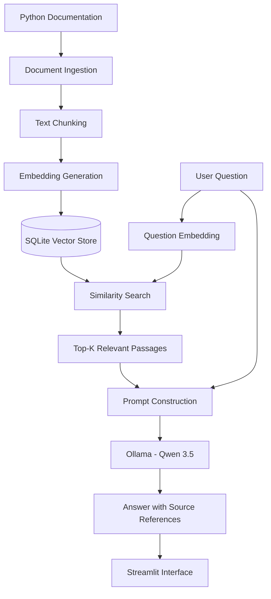

# System Architecture

The AI Knowledge Assistant uses Retrieval-Augmented Generation (RAG) to answer questions using a local collection of Python documentation.

## Architecture Diagram

## Main Components

1. **Document ingestion:** Loads Python documentation from the documents directory.
2. **Chunking:** Splits documents into smaller overlapping text passages.
3. **Embedding:** Converts document passages into numerical vectors using Nomic Embed Text.
4. **Vector storage:** Stores embeddings and document metadata in SQLite.
5. **Retrieval:** Converts the user's question into an embedding and finds similar passages using cosine similarity.
6. **Generation:** Sends the question and retrieved evidence to Qwen 3.5 through Ollama.
7. **Presentation:** Displays the generated answer and retrieved source passages through Streamlit.

## Technology

- Python: Application logic and pipeline orchestration
- Ollama: Local model execution
- Qwen 3.5: Answer generation
- Nomic Embed Text: Embedding generation
- SQLite: Local vector and document storage
- Streamlit: User interface
